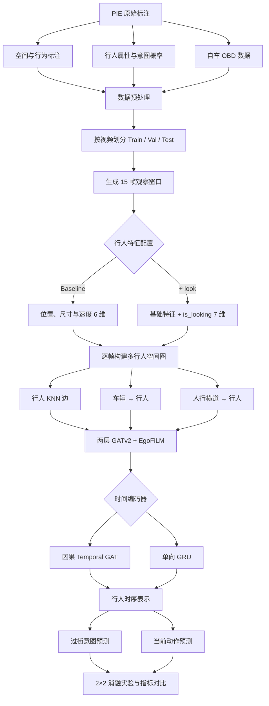
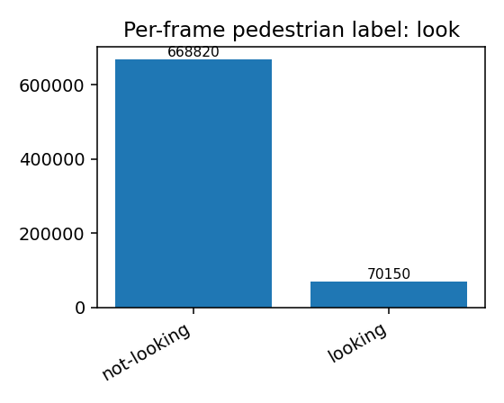

# PIE Pedestrian Intention & Action Prediction

基于 PIE 数据集的多行人时空图学习实验：使用共享的 GATv2 空间编码器，对比因果 Temporal GAT 与单向 GRU，并通过 2×2 消融实验分析 `look` 行为特征对过街意图和当前动作预测的影响。

## 项目流程



## 结果摘要

| 模型 | look | 参数量 | 意图 F1 | 动作 F1 |
|---|---:|---:|---:|---:|
| Temporal GAT | 否 | 239,106 | 0.7934 | **0.7545** |
| Temporal GAT | 是 | 239,234 | **0.8287** | 0.7504 |
| GRU | 否 | 369,410 | 0.8112 | 0.7347 |
| GRU | 是 | 369,538 | 0.8182 | 0.7346 |

加入 `look` 后，Temporal GAT 的意图 F1 提升 0.0353，GRU 提升 0.0070；动作 F1 没有改善。详细设计、训练设置与讨论见 [研究摘要](docs/RESEARCH_REPORT.md)，完整指标见 [CSV](results/final_report_metrics.csv)。



## 项目结构

```text
configs/                 四组最终消融实验配置
src/preprocess.py        PIE XML 解析、视频级划分与窗口生成
src/graph_builder.py     多行人空间图构建
src/dataset.py           15 帧序列数据集
src/models/              GRU 与 Temporal GAT 模型
src/train.py             统一训练入口
analysis/                数据集统计脚本
docs/                    匿名化研究说明与图表
results/                 最终报告指标
```

## 环境

- Python 3.10+
- PyTorch 2.x
- PyTorch Geometric
- scikit-learn、PyYAML

```bash
python -m venv .venv
source .venv/bin/activate
pip install -r requirements.txt
```

## 数据准备

从 [PIE 官方仓库](https://github.com/aras62/PIE) 获取标注。项目不会重新分发数据；本地目录需包含：

```text
PIE_ROOT/
├── annotations/
├── annotations_attributes/
└── annotations_vehicle/
```

预处理：

```bash
python src/preprocess.py \
  --pie-root /path/to/PIE_ROOT \
  --output data/processed
```

该命令使用最终报告设置：15 帧窗口、步长 15、随机种子 42、按视频 70/15/15 划分。
在本项目使用的 53 个视频标注上，会得到 12,393 个训练窗口和 3,292 个验证窗口；训练配置从验证集固定抽取 30%（987 个窗口）。

## 训练四组实验

```bash
python src/train.py --config configs/temporal_gat_baseline.yaml
python src/train.py --config configs/temporal_gat_look.yaml
python src/train.py --config configs/gru_baseline.yaml
python src/train.py --config configs/gru_look.yaml
```

权重输出到 `outputs/`，该目录默认不提交。由于训练依赖随机初始化、硬件环境及上游数据版本，复现实验数值可能出现小幅波动。

## 数据分析

```bash
python analysis/analyze_pie_dataset.py --help
```

## 说明

- 原始 PIE 数据、预处理后的 `.pt` 文件和训练权重未上传。
- 原始课程报告包含姓名与学号，仓库仅提供匿名化研究摘要。
- 本仓库代码采用 MIT License；PIE 数据及相关资产仍受其原始许可约束，请同时遵守 [PIE 官方说明](https://data.nvision2.eecs.yorku.ca/PIE_dataset/)。
- 此仓库仅整理最终报告中实际完成的功能。反事实解释属于未来工作，不作为现有实现声明。

## 引用

```bibtex
@inproceedings{Rasouli2019PIE,
  author    = {Amir Rasouli and Iuliia Kotseruba and Toni Kunic and John K. Tsotsos},
  title     = {PIE: A Large-Scale Dataset and Models for Pedestrian Intention Estimation and Trajectory Prediction},
  booktitle = {International Conference on Computer Vision (ICCV)},
  year      = {2019}
}
```
