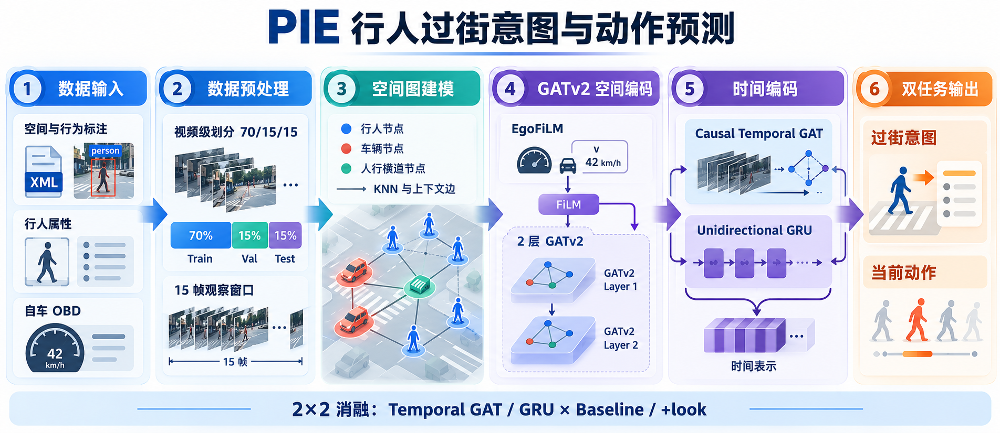
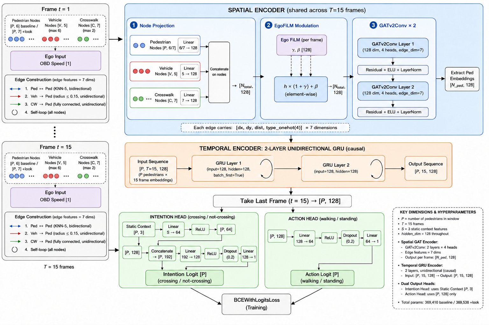
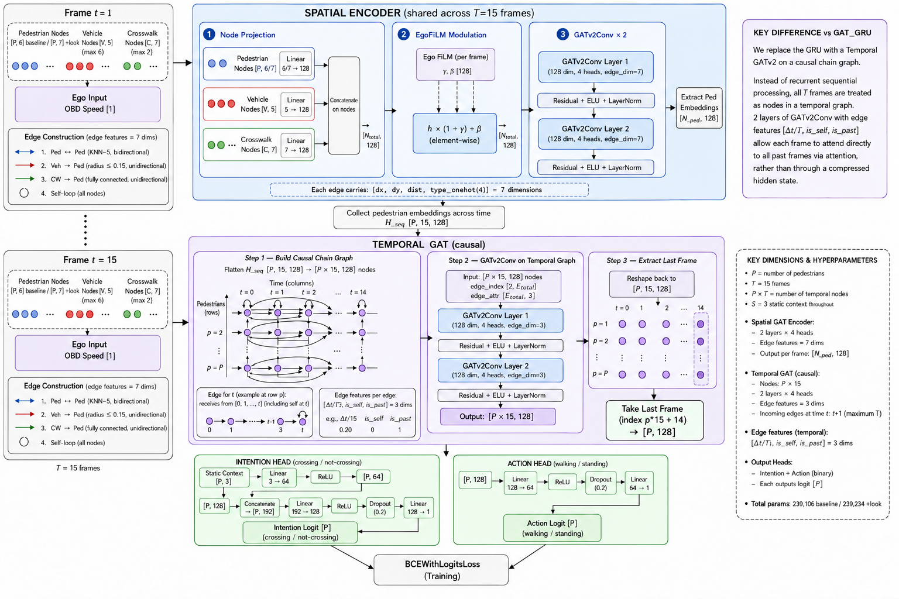
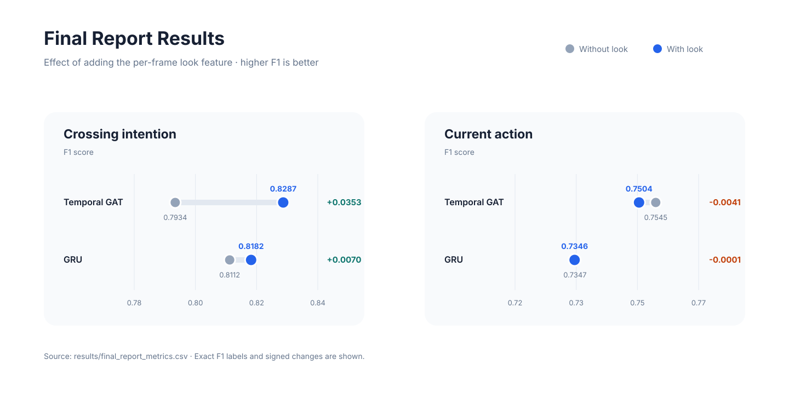

# PIE Pedestrian Intention & Action Prediction

基于 PIE 数据集的多行人时空图学习实验：使用共享的 GATv2 空间编码器，对比因果 Temporal GAT 与单向 GRU，并通过 2×2 消融实验分析 `look` 行为特征对过街意图和当前动作预测的影响。

## 项目背景

在自动驾驶场景中，仅判断行人当前是否正在移动并不足以支持提前决策。车辆还需要结合行人位置、运动状态、周围车辆、人行横道和自车速度，判断行人是否具有过街意图。本项目将交通场景表示为随时间变化的图，并同时完成两个二分类任务：

- **过街意图预测**：crossing / not-crossing；
- **当前动作识别**：walking / standing。

实验重点回答两个问题：在相同空间编码器下，因果 Temporal GAT 与单向 GRU 哪种时间建模方式更适合该任务；逐帧加入 `look`（行人是否注视）后，两项任务是否会获得相同收益。

## 核心设计

1. 解析 PIE 的行人、场景属性和车辆 OBD 标注，并按帧对齐多源信息。
2. 将连续 15 帧组成一个观察窗口，以视频为单位划分数据，避免同一视频跨集合造成数据泄漏。
3. 每帧构建包含行人、车辆和人行横道的空间图，通过两层 GATv2 编码交通参与者之间的关系。
4. 提取并对齐各帧的行人表示，再分别使用因果 Temporal GAT 或单向 GRU 建模时间变化。
5. 使用独立的意图预测头和动作预测头输出逐行人二分类结果。

### 节点与关系

| 节点类型 | 输入特征 | 作用 |
|---|---|---|
| 行人 | 位置、尺寸、速度；消融实验增加 `is_looking` | 主要预测对象 |
| 车辆 | 位置、尺寸、车辆标记 | 表示邻近动态交通参与者 |
| 人行横道 | 位置、尺寸、交通灯状态 | 提供道路与过街环境信息 |
| 自车状态 | 归一化 OBD 速度 | 通过 EgoFiLM 调制节点表示 |

空间边包括行人之间的 KNN 双向边、邻近车辆到行人的有向边、人行横道到行人的有向边以及所有节点的自环。边特征由相对位置、距离和关系类型组成。

## 项目流程



## 模型架构详图

### GATv2 + GRU



空间编码后的行人表示按时间组成序列，由两层单向 GRU 顺序处理；最后一帧的隐藏表示进入两个预测头。该模型作为循环时间建模基线。

### GATv2 + Temporal GAT



15 帧行人表示被展开为时间图节点，并建立从过去帧指向当前帧的因果边。两层 Temporal GATv2 通过注意力直接聚合历史信息，时间边特征包含归一化时间差、自环标记和历史标记。

## 结果摘要

| 模型 | look | 参数量 | 意图 F1 | 动作 F1 |
|---|---:|---:|---:|---:|
| Temporal GAT | 否 | 239,106 | 0.7934 | **0.7545** |
| Temporal GAT | 是 | 239,234 | **0.8287** | 0.7504 |
| GRU | 否 | 369,410 | 0.8112 | 0.7347 |
| GRU | 是 | 369,538 | 0.8182 | 0.7346 |

加入 `look` 后，Temporal GAT 的意图 F1 提升 0.0353，GRU 提升 0.0070；动作 F1 没有改善。详细设计、训练设置与讨论见 [研究摘要](docs/RESEARCH_REPORT.md)，完整指标见 [CSV](results/final_report_metrics.csv)。



### 结果解读

- **最佳意图预测结果**来自 Temporal GAT + `look`，F1 为 **0.8287**。
- 加入 `look` 后，Temporal GAT 的意图 F1 提升 **3.53 个百分点**，GRU 提升 **0.70 个百分点**。
- `look` 没有改善动作 F1，说明注视行为更接近过街决策前的意图信号，而不等同于已经发生的行走动作。
- Temporal GAT 的参数量约为 23.9 万，低于 GRU 的约 36.9 万；在 +`look` 配置下仍获得更高的意图 F1。

## 项目结构

```text
configs/                 四组最终消融实验配置
src/preprocess.py        PIE XML 解析、视频级划分与窗口生成
src/graph_builder.py     多行人空间图构建
src/dataset.py           15 帧序列数据集
src/models/              GRU 与 Temporal GAT 模型
src/train.py             统一训练入口
analysis/                数据统计与结果图生成脚本
docs/                    匿名化研究说明与图表
results/                 最终报告指标
```

## 环境

- Python 3.10+
- PyTorch 2.x
- PyTorch Geometric
- scikit-learn、PyYAML

```bash
python -m venv .venv
source .venv/bin/activate
pip install -r requirements.txt
```

## 数据准备

从 [PIE 官方仓库](https://github.com/aras62/PIE) 获取标注。项目不会重新分发数据；本地目录需包含：

```text
PIE_ROOT/
├── annotations/
├── annotations_attributes/
└── annotations_vehicle/
```

预处理：

```bash
python src/preprocess.py \
  --pie-root /path/to/PIE_ROOT \
  --output data/processed
```

该命令使用最终报告设置：15 帧窗口、步长 15、随机种子 42、按视频 70/15/15 划分。
在本项目使用的 53 个视频标注上，会得到 12,393 个训练窗口和 3,292 个验证窗口；训练配置从验证集固定抽取 30%（987 个窗口）。

## 训练四组实验

四组配置只改变时间编码器与是否使用 `look`，其余主要训练设置保持一致，以形成可对照的 2×2 消融实验：

| 配置文件 | 时间编码器 | look 特征 |
|---|---|---:|
| `temporal_gat_baseline.yaml` | Temporal GAT | 否 |
| `temporal_gat_look.yaml` | Temporal GAT | 是 |
| `gru_baseline.yaml` | GRU | 否 |
| `gru_look.yaml` | GRU | 是 |

```bash
python src/train.py --config configs/temporal_gat_baseline.yaml
python src/train.py --config configs/temporal_gat_look.yaml
python src/train.py --config configs/gru_baseline.yaml
python src/train.py --config configs/gru_look.yaml
```

权重输出到 `outputs/`，该目录默认不提交。由于训练依赖随机初始化、硬件环境及上游数据版本，复现实验数值可能出现小幅波动。

## 数据分析

```bash
python analysis/analyze_pie_dataset.py --help
```

重新生成 README 中的最终结果图：

```bash
python analysis/plot_final_results.py
```

## 局限与后续方向

- 当前模型使用结构化标注特征，没有引入 RGB 图像或行人外观特征。
- 实验只验证了 15 帧观察窗口和行人 KNN `k=5` 的设置。
- `look` 目前作为逐帧输入特征使用，尚未单独建模注视状态的持续时间和变化趋势。
- 反事实图解释属于后续研究方向，不作为当前仓库已实现功能。

## 说明

- PIE 数据与训练权重不随仓库分发，请按上述步骤自行准备。
- 项目代码采用 MIT License；数据使用请遵守 [PIE 官方许可](https://data.nvision2.eecs.yorku.ca/PIE_dataset/)。

## 引用

```bibtex
@inproceedings{Rasouli2019PIE,
  author    = {Amir Rasouli and Iuliia Kotseruba and Toni Kunic and John K. Tsotsos},
  title     = {PIE: A Large-Scale Dataset and Models for Pedestrian Intention Estimation and Trajectory Prediction},
  booktitle = {International Conference on Computer Vision (ICCV)},
  year      = {2019}
}
```
